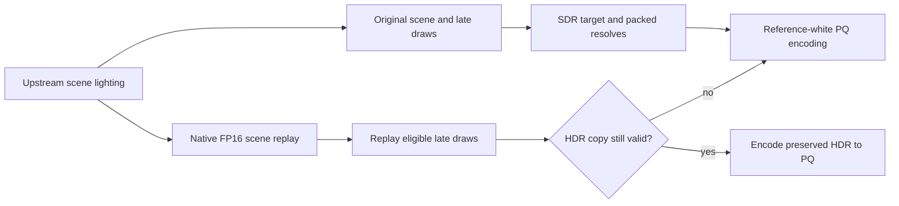

# Gears 3 HDR fallback investigation — 2026-11-14

## Installed follow-up

The normal Gears 2 and Gears 3 executables were rebuilt and installed after this
investigation. The implementation now handles padded stencil attachments using
a matching FP16 temporary target and clipped-region copies; verifies/restores
known CPU atlas contents after render-memory reuse; retains fingerprinted,
vertex/blend-restricted compressed-atlas UI handling; and recognizes the validated
vertex-color rectangle-fill pair. RGBA8 scene sources remain excluded from
ordinary UI. Reference-frame reason counters and detailed classifier diagnostics
cover the remaining unclassified effects and internal setup failures.

The complete core suite passed **223 test cases / 1,105,287 assertions**. All
**12 GPU runs** passed on D3D12 and Vulkan: padded stencil replay, automatic
overlays (224 production translator draws per API), paired scene effects,
Gears 2 and Gears 3 grading, and scene/UI transitions. The stencil fixture also
checks nonzero scissor origins, untouched HDR and unchanged depth/stencil across
repeated replays. Both installed executables passed AMD64/import/runtime checks.

Previous executables are saved under
`work/hdr-fallback-investigation-20261114/before-install`. That directory's
parent contains `install-manifest.json`, `verification.json`, `core-tests.log`
and `gpu-results.json`. The live follow-up was backed up separately under
`before-install-followup`, with its manifest in `install-followup.json`.
See [current overlay behavior](automatic-hdr-overlays.md)
for the restrictions and temporary-target cost. These checks do not
establish that every gameplay effect is covered or measure whole-game cost.

### Live follow-up after the first installation

Session `20261114-201344` confirms thousands of padded stencil replays with zero
depth/stencil rejection frames. It also exposed overly conservative page-level
provenance for BC atlases and a missing captured vertex role. The follow-up adds
the menu Canvas VS pair and accepts compressed atlas inputs for fingerprinted,
vertex/blend-restricted material profiles even when their guest pages have GPU
ownership flags. Uncompressed scene sources stay guarded.

A gameplay snapshot captured the remaining repeated writer `A1960D34295C6114`
(host `DED6FC67`), paired with VS `0D6CF2CCA4EA03FB`. Draw 1248 samples a 128x128
BC3 texture plus two 256x256 BC1 textures with nine mip levels, blends with source
alpha/inverse source alpha, and has no scene input. It now has a restricted
fingerprint profile. Its actual native pixel shader and matching vertex shader
pass FP16 pipeline creation on D3D12 and Vulkan in addition to the 12 GPU runs.
`remaining-material-bindings.json` records this draw and the 2048x2048 BC3 HUD
atlas captured for material `56B153DABC9D68B3`.

Two premultiplied transition materials (`8356D7C3D65FE328`,
`212F89E82422D29D`, VS `D46B09B3080599F8`) also appeared briefly in this log.
Their exact affected inputs were not in the available snapshots and remain
guarded. The new rejected-input diagnostics include each bound texture's format,
dimensions and handle; periodic summaries identify the last rejected shader.

The remainder of this document records the pre-fix investigation.

## Finding

COGBox is deliberately replacing its native HDR image with the completed SDR reference when it cannot reproduce a later draw in its separate HDR composition. HDR10 output stays enabled. This is a renderer coverage/state problem; changing paper white, peak brightness or the tone mapper cannot repair the missing composition.

The newest session inspected is `Gears2-Native/cogbox/build/Gears3/logs/20261114-172651/gow3.log`, launched with the normal `Gears3-Native/build/Release-tu6/gow3.exe`. The executable is 84,582,912 bytes and matches the size recorded by the latest automatic-overlay installation. The log also contains the new automatic-overlay compilation messages. This is not merely evidence from the older profile-only implementation.

At the checkpoint timestamp **17:42:36.846 as written in the log**, the counters were 7,760 FP16 frames and 91,540 reference frames out of 99,300 (92.2% reference). This includes startup, menus, transitions and gameplay; it is not a gameplay-only failure rate. The running session continued after that checkpoint.

## Pipeline classification and resource chain

The log confirms `D3D12Presenter: HDR10 colour space set (support flags 1)` at line 68. Native settings are scene white 200 nits, UI white 203 nits and peak 3,800 nits. DevKit independently reports a 3840×2160 `R10G10B10A2_UNORM` swapchain.

The scene shader is replayed into linear FP16. Supported UI/effects are reproduced there, while the original guest target, packed resolves and memory transfers remain intact. At presentation, `native_hdr_valid_` and the resolve generation select either this float image or the packed SDR image. The latter is gamma-decoded, scaled by scene white and encoded to PQ/BT.2020 without highlight expansion. Its maximum neutral level is therefore about 200 nits in this session, even though the HDR display peak setting is 3,800 nits.

Relevant implementation: `shadow_renderer.cpp` lines 3571, 3993–4035 and 4038–4212; `native_hdr_shaders.h` lines 55–78.

## Confirmed rejection mechanisms

### 1. The stencil replay compares visible size with allocation size

The original target cache allocates both color and depth/stencil targets at **3840×6144**, based on Xbox EDRAM layout. The native HDR image is cropped to **3840×2160**, based on the scene scissor. These are two different meanings of height.

`NativeHdrDraw` requires a depth/stencil attachment's width and height to exactly equal `native_hdr_w_` and `native_hdr_h_` (lines 4082–4083). Consequently the allocated depth target fails the replay check for the cropped HDR image. Recognizing the UI shader does not overcome this check.

Evidence from the latest log:

| Log line | Guest pixel shader | State | Result |
|---|---|---|---|
| 237 | Depth target creation | D24S8, base 720, pitch 1280, 3840×6144 | Allocated depth/stencil size |
| 419 | Additional depth target creation | D24FS8, base 0, pitch 1280, 3840×6144 | Same allocated extent |
| 438 | Native presentation | 3840×2160 | Visible HDR image size |
| 512 | `A7AB2D75C169DFDE` | Known menu color; Canvas true, stencil true | supported false; frame invalidated |
| 718 | `19055C4D86C6C08C` | Known menu atlas; Canvas true, stencil true | supported false; frame invalidated |

The clear/fill shader `A4A965C189287B99` also fails at line 565 with stencil enabled. It has no established screen-space overlay classification, so fixing the dimension check alone does not prove that draw is covered. Its actual color writes and clear/alias semantics must be preserved.

### 2. Texture classification remembers historical GPU use permanently

`TextureCache::RenderSourceMask` (`texture_cache.cpp`, line 637) treats any texture allocation touching a page for which `NeverResolved` is false as render-derived. `GuestWatch::NeverResolved` checks `kEverGpuWritten`, and `BumpPages` deliberately retains that flag through CPU writes.

Thus a complete later CPU upload into reused memory still fails the independent-UI rule. This behavior is explicitly expected by the existing regression at `layer0_texture_cache_test.cpp`, line 420. It is conservative, but loses the distinction between a current scene texture and a new atlas occupying old render memory. It may make coverage depend on allocation history.

This is a confirmed source-level rejection mechanism, **not a proven attribution for every unexplained draw in this log**. The current log omits the render-source mask, source readiness, sampled allocation identity and other classifier inputs.

### 3. Supported target state does not mean supported material

Two additional failures are logged:

| Log line | Guest shader / original host CRC | What is established |
|---|---|---|
| 817 | `56B153DABC9D68B3` / `9C1EE0CA` | Known Canvas profile; `Canvas true, supported true`; nevertheless rejected. An automatic variant had just compiled successfully. The draw failed material/classification eligibility, not the printed basic target-state check. |
| 1129 | `A1960D34295C6114` / `DED6FC67` | `Canvas false, supported true`; neither independent-overlay nor scene-pair eligibility succeeded. Static shader inventory shows three 2D input slots; that alone cannot establish whether those inputs are UI or scene data. |

Both shaders were absent from the new live snapshot, so their failing texture bindings remain unconfirmed. The source has additional failure exits for pipeline/resource creation and scene setup that do not emit the later-writer diagnostic.

The diagnostic logs each pixel-shader hash only once per session. Five messages do not mean five failed frames, and a subsequent failure of the same shader with different state may be invisible.

## Live validation and HDR source proof

The connected process was Gears 3 PID 11760. A fresh DevKit snapshot contained 682 operations. Draw 550 used menu shader `2F8879EC`, straight-alpha blending and the original 3840×6144 RGBA8 target. Draw 670 resolved that target into an `R32_UINT` packed destination. Draw 679 ran encoder `A0A1A9E6` with **SRV1 named `HDR reference-white fallback`**, 3840×2160, and no native FP16 input bound. This independently confirms actual fallback rendering, rather than a misleading log label.

Saved bindings and counters: `work/hdr-fallback-investigation-20261114/evidence.json`.

Earlier native-HDR investigations establish upstream float lighting and successful float output with values above reference white; see `native-hdr-gears2.md` and `native-hdr-gears3.md`. This investigation did not perform a new luminance readback or a synchronized before/after image comparison. Its new evidence proves the rejection/output path, not the current scene's precise luminance.

## Why RenoDX generally behaves differently

RenoDX commonly upgrades or clones selected resources to FP16, replaces the relevant shaders, preserves the intervening resource chain, and encodes at final output. It does not inherently require COGBox's per-frame all-or-nothing validity switch. For example, the [Dishonored addon](https://github.com/clshortfuse/renodx/blob/main/src/games/dishonored/addon.cpp) configures resource-view cloning, FP16 upgrades and a final HDR10 proxy.

That pattern explains why a working RenoDX mod need not exhibit this particular whole-frame fallback. It does not establish that every RenoDX mod handles every UI/effect correctly. COGBox also has extra constraints: guest memory resolves and Xbox EDRAM format aliasing mean that globally replacing every RGBA8 target with FP16 would break assumptions elsewhere in the renderer.

## Online findings

I did not find an indexed public report of this exact COGBox fallback mechanism. Related primary-source reports show that UI and resource-chain compatibility also cause problems in RenoDX:

- [Code Vein 2 discussion #494](https://github.com/clshortfuse/renodx/discussions/494): the mod author explains that SDR font transparency required special handling in the native HDR path. Useful lesson: preserve the effect's expected input domain and coverage.
- [Oblivion Remastered PR #713](https://github.com/clshortfuse/renodx/pull/713): writing constant alpha across an HDR composite made frame generation treat the entire frame as UI. The proposed change preserves UI alpha; the author and another user report successful testing. This is a related composition bug, not the same SDR fallback, and the PR was open when inspected.
- [MHGURecomp HDR design](https://github.com/morerokk/MHGURecomp/blob/master/docs/HDR.md): a comparable recompilation project describes carrying float targets through grading, post-processing and HUD stages. Its page explicitly says it was built but not yet tested in game, so it is architectural inspiration rather than validation for COGBox.
- [Microsoft mixed render-target resolution specification](https://microsoft.github.io/DirectX-Specs/d3d/VulkanOn12.html#mixed-render-target-resolutions): mismatched attachment sizes depend on feature support and bounded viewport/scissor. Replacing the equality test with `>=` without checking the API/backend contract is not a portable fix.

## Format/proxy plan and target decision

Keep the genuine upstream scene signal, existing mapper and HDR10 output. Repair continuity through later draws in this order:

1. **Make stencil replay compatible with the HDR attachment.** Separate allocated extent from visible extent. A matching-extent FP16 companion with explicit visible-region addressing is a portable option; a compatible depth/stencil copy or a feature-checked mixed-size path are alternatives. Preserve clipping, stencil comparison and pre-draw state. Account for the memory cost of a padded FP16 image. Do not disable stencil to pass the check.
2. **Track content lifetime for texture eligibility.** Add provenance that can distinguish fully replaced CPU texture contents from prior GPU use, including base/mips and partial overlaps. Keep `NeverResolved` semantics for its existing callers. A simple switch to `GpuCurrent` is insufficient because invalidation granularity and partial CPU writes do not prove every sampled texel was replaced.
3. **Capture the two outstanding gameplay materials at failure.** Decide bounded UI versus scene-reading effect from actual bound inputs, draw state and shader behavior. Extend generic handling only for proven cases. A hash whitelist alone would bypass the reason the classifier exists.
4. **Extend HDR resource propagation.** Over time, carry a versioned HDR companion through the relevant resolves, copies, clears, later effects and aliases. Keep guest integer storage intact. This applies RenoDX's resource-preservation idea inside COGBox's renderer and reduces dependence on the final-scene replay staying untouched.

Keeping stale HDR frames, ignoring later draws, or multiplying the final SDR image by peak brightness would conceal the failure while losing correct composition or real highlight information.

## Handoff and verification

Before changing selection rules, record the first invalidator per frame with a reason enum and aggregated counts: allocated/visible dimensions, depth target identity, scene generation, PS/VS, overlay mode, texture-ready flag, render-source mask, input formats/ranges/versions and scene-pair rejection reason. Include pipeline/resource failures and no-scene/generation-mismatch reference frames. This will distinguish intentional loading/video reference frames from lost gameplay HDR without logging every draw.

Validation should exercise stencil-clipped menus with the observed padded target sizes on D3D12 and Vulkan; complete and partial CPU reuse of formerly resolved texture memory; reload/damage/post-process transitions; and actual scene-reading materials. Check that native highlights remain above scene white through those draws, UI stays bounded, fades reach black, and a subsequent frame never reuses stale HDR. Collect reason counts and matched captures before claiming gameplay coverage.

The initial investigation produced a diagnosis, live binding evidence and a repair plan. Its installed implementation follow-up is recorded above.

## Shared transport follow-up

The shared renderer now implements versioned FP16 target/resolve companions,
partial and scaled copies, regional clear/alias synchronisation, per-input
material transport and exact resolved-resource presentation. The implementation
and remaining format/scene integration limits are described in
[HDR resource transport](hdr-resource-transport.md). It was built and installed
for Gears 2 and Gears 3 with previous executable backups.

Validation passed 228 CPU test cases (1,105,320 assertions) and 18 GPU runs:
seven game-free modes per API plus both captured Gears 3 blur materials with
their matching vertex shader on D3D12 and Vulkan. The first shared-transport build was rolled back after live colour/performance
regressions. Its corrected follow-up restores framebuffer swizzle handling,
uses shared copy-on-write versions, renders overlays directly to padded
companions and fixes SMAA visible-extent sampling. Final validation includes
those regressions and synthetic copy-cost benchmarks. Live transition verification
of the corrected follow-up is pending; these results do not establish every game's native HDR coverage.
